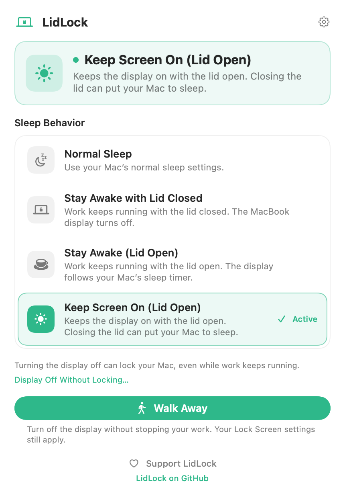

# LidLock

LidLock controls when your Mac and display sleep. It is free and runs on macOS 13 or later.

[Download LidLock 1.2.6](https://github.com/DelPage/lidlock/releases/latest/download/LidLock.dmg)

## Sleep modes

| Mode | Behavior |
|---|---|
| Normal Sleep | Follow macOS sleep settings. |
| Stay Awake with Lid Closed | Keep tasks running with the screen dark and Mac unlocked. |
| Stay Awake (Lid Open) | Keep tasks running. Let the display sleep. |
| Keep Screen On (Lid Open) | Keep the Mac and display awake. |

Closed-lid mode restores brightness when you open the lid and leaves your Mac's lock settings unchanged.

**Turn Display Off** turns off the display immediately while tasks continue. This action uses your Mac's lock settings.

## Install

Open the download, drag LidLock to Applications, and open it. Choose a mode in the window or menu bar.

[Help and settings](GETTING_STARTED.md) · [Report a problem](https://github.com/DelPage/lidlock/issues)

## Download details

Apple Developer ID signed and notarized. Published by DelPage Technologies LLC.

- Version: 1.2.6
- SHA-256: `c335f13b1b962940c1f45f6c9e502c1eafae40b8370212e3790c74e3240419f0`
- [Release notes](CHANGELOG.md)

## Privacy and support

LidLock has no accounts, analytics, or automatic network connections. Read the [privacy policy](PRIVACY.md).

[Optional donations](SUPPORT.md) support maintenance. All features work without a donation.

This repository contains downloads, documentation, and issue tracking. The app's source code is private. See the [EULA](EULA.md) and [contribution guidelines](CONTRIBUTING.md).
