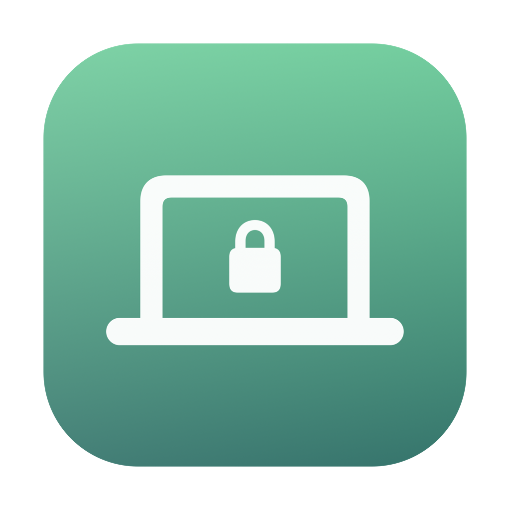
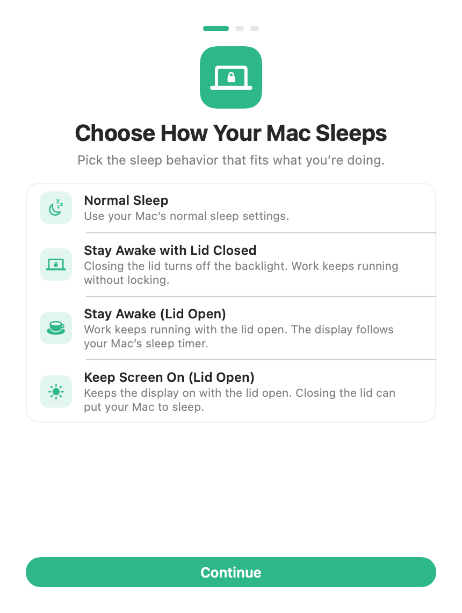

# LidLock

Keep your Mac working, even with the lid closed.

LidLock keeps your Mac awake for downloads, local servers, automations, and long
builds. Whether work continues depends on the app and macOS. It is free to use
and requires no Terminal commands.

Published by DelPage Technologies.

  

  

## Free Download

- [Download LidLock.dmg](https://github.com/DelPage/lidlock/releases/latest/download/LidLock.dmg)
- Current version: **1.2.5**
- SHA-256: `ec3df89c82d5fd67ac93173a1f873379db68becf5b999361e511e3d45f2f8898`

LidLock requires **macOS 13 Ventura or newer**. DelPage signs the app with
Apple Developer ID, and Apple notarizes it.

## Getting Started

LidLock tells you before macOS needs an administrator password or approval in
Login Items. Reopen the setup guide from **Settings**, then **Getting Started**.

[Read the installation and permissions guide](GETTING_STARTED.md).

## What It Does

- **Normal Sleep** uses your Mac's normal sleep settings.
- **Stay Awake with Lid Closed** keeps work running without locking. The backlight turns off when the lid closes and brightness returns when it opens.
- **Stay Awake (Lid Open)** keeps work running with the lid open. The display follows your Mac’s sleep timer.
- **Keep Screen On (Lid Open)** keeps the display on with the lid open. Closing the lid can put your Mac to sleep.
- **Walk Away** turns the display off without stopping your work. This action follows your normal Lock Screen settings.
- Closing the window leaves LidLock in the menu bar. Use **Open LidLock** to
  reopen it or **Quit LidLock** to exit.

## Display Off Without Locking

Choose **Stay Awake with Lid Closed** before closing your MacBook. Your work
keeps running and your session stays unlocked. LidLock switches off the
backlight while the lid is closed and restores your brightness when it opens.

The display session stays awake internally. Turning off the backlight saves
power, but running tasks still use battery. Your Mac’s lock settings stay
unchanged. You can still lock the Mac yourself, and LidLock does not unlock an
already locked Mac.

## Permissions

| Feature | Approval | Why |
|---|---|---|
| Normal Sleep, Stay Awake, Keep Screen On, and Walk Away | None | Available as soon as LidLock opens. |
| Stay Awake with Lid Closed | Administrator password unless **Allow lid changes without a password** is enabled | macOS protects changes to lid sleep behavior. |
| Allow lid changes without a password | Login Items approval may be required | Avoids password prompts for lid changes. |
| Open at login | Login Items approval may be required | Lets LidLock open when you sign in. |

When approval is needed, LidLock explains why and can open Login Items.

LidLock does not request access to files, screen contents, camera, microphone,
location, contacts, or Accessibility controls. Read
[Getting Started](GETTING_STARTED.md#permissions-and-approvals) for details.

## Interface

| Sleep controls | First launch guide |
|---|---|
|  |  |

## Privacy

LidLock has no accounts, analytics, telemetry, advertising, or automatic
network access while it runs.

Read the [LidLock privacy policy](PRIVACY.md).

## Support LidLock

LidLock works the same whether or not you donate. Optional donations support
continued maintenance. Visit [Support LidLock](SUPPORT.md) to contribute.

## Bug Reports

Use [GitHub Issues](https://github.com/DelPage/lidlock/issues) for bug reports
and compatibility notes. Include your macOS version, Mac model, LidLock
version, and what you expected to happen.

## Repository

This repository contains LidLock downloads, documentation, screenshots, and
issue tracking. The app's source code is not public. See the [EULA](EULA.md)
for license terms and [CONTRIBUTING](CONTRIBUTING.md) for what belongs here.

## Links

- Releases: [GitHub Releases](https://github.com/DelPage/lidlock/releases)
- Getting started: [GETTING_STARTED.md](GETTING_STARTED.md)
- Privacy policy: [PRIVACY.md](PRIVACY.md)
- Support: [SUPPORT.md](SUPPORT.md)
- Changelog: [CHANGELOG.md](CHANGELOG.md)
